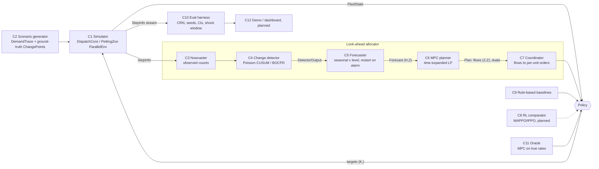

# P7 architecture — components, contracts, isolated metrics

Typed contracts live in [contracts/contracts.py](contracts/contracts.py) (`CONTRACT_VERSION = "1.0.0"`). Shapes: Z zones, K units (agents), H look-ahead steps, T episode steps. One step = 1 simulated minute.

| # | Component | Responsibility | Input → Output contract | Calls → | Baseline implementation | Isolated scalar metric | SLO |
|---|---|---|---|---|---|---|---|
| C1 | Simulator | Advance the world one step with a fixed, shared matching rule | `targets (K,) int` → `StepInfo`; `state() → FleetState` | trace (C2) | `components/simulator/core.py`, `pz_env.py` (PettingZoo 1.27 ParallelEnv) | steps/s at Z=25, K=40 (≥5k/s target); conservation and determinism tests pass | deterministic given seed |
| C2 | Scenario generator | Non-stationary demand with labelled shocks, drifts and spikes | `ScenarioConfig, seed` → `DemandTrace` | — | `components/scenarios/scenarios.py` | empirical vs configured rate (Poisson deviance); label correctness | O(T·Z) |
| C3 | Nowcaster | Turn observed arrivals into a current demand level | `counts (Z,)` per step → level `(Z,)` | — | EWMA / moving average in `forecasting/forecasters.py` | nowcast MAE vs true rate | O(Z)/step |
| C4 | Change detector | Declare per-zone regime changes and estimate the onset | `counts (Z,), expected (Z,)` → `DetectorOutput(alarm, stat, change_start)` | — | `detection/detectors.py` PoissonCusum (two-sided) | detection delay at a fixed false-alarm rate (ARL₀) on labelled shocks; F1 with margin | O(Z)/step |
| C5 | Forecaster | H-step demand belief, absorbing shocks (restart) and drift (slow EWMA) | `observe(t, counts)`; `forecast(t, H)` → `Forecast(mean (H,Z), upper?)` | C4 | `ChangeAwareForecaster`, `EWMAForecaster`, `OracleForecaster` | horizon-averaged MAE / Poisson deviance vs true rates, overall and in the 120-step post-shock window | <1 ms |
| C6 | MPC planner | Choose moves that maximise expected service minus move and wait costs over H | `idle (Z,), incoming (H,Z), queue (Z,), trust × demand (H,Z)` → `Plan(flows (Z,Z) int, objective, solve_ms, zone_value duals)` | — (HiGHS, warm-started) | `planner/mpc.py` time-expanded LP (hop edges arrive after L steps, OD trip flows, backlog with fluid abandonment 1/P) | (a) served fraction under the true-rate forecast (isolates planning from forecasting); (b) per-step latency (median 6.0 ms, mvp-v2) | median < 10 ms |
| C7 | Coordinator | Convert zone flows into per-unit orders without conflicts | `Plan.flows, FleetState` → `targets (K,)` | — | `coordinator/assign.py` (lowest-index idle units; Hungarian for transport) | assignment cost / optimal (= 1.0 for interchangeable units) | O(K) |
| C8 | RL comparator (planned) | Learned decentralised policy on the PettingZoo API | per-unit obs `(4Z+6,)` → `Discrete(Z)` | C1 via PettingZoo | MAPPO/IPPO with TorchRL (planned) | end-to-end served fraction on the frozen test seeds | — |
| C9 | Rule-based baselines | Required MVP baseline allocators | `FleetState` → `targets (K,)` | C7 | `policies/policies.py`: static, greedy, reactive | end-to-end (they are the yardstick) | — |
| C10 | Eval harness | Policy × scenario × seed grid with common random numbers; CIs and paired tests | job dict → episode row (served_frac, lost_frac, waits, empty moves, shock_lost, recover_steps, solve_ms) | C1, C2, policies | `eval/harness.py`, `eval/stats.py` | CI half-width of the primary metric; bitwise reproducibility | — |
| C11 | True-rate reference (`oracle`) | MPC fed the true expected rates: a perfect *forecast*, not a hindsight optimum or upper bound. On NYC it is a retrospective smoother of realised demand. | rates `(T,Z)` → `Forecast` | — | `OracleForecaster` + C6 | — | — |
| C12 | Demo dashboard (planned) | Live grid: demand heat map, units, detector alarms; judges inject a shock | sim stream → UI | C1, C4 | (planned: matplotlib/Plotly or a web canvas) | frames/s; "click-to-shock" latency | — |

**Seams (what can be swapped independently):**
- `DemandForecaster`: any forecaster works in the MPC policy.
- `Plan`: any planner works, e.g. a min-cost-flow or MCTS planner.
- `Policy`: baselines, the look-ahead stack and RL all plug into the same harness.

The PettingZoo wrapper and `DispatchCore` must produce identical trajectories (contract test).

**Fixed simulator semantics (shared by all policies):** same-zone FIFO matching, patience P = 10 steps, Manhattan travel at 1 step per hop, trip duration max(1, hops). Policies differ **only** in where idle units are sent. That is the allocation decision the problem asks about.
