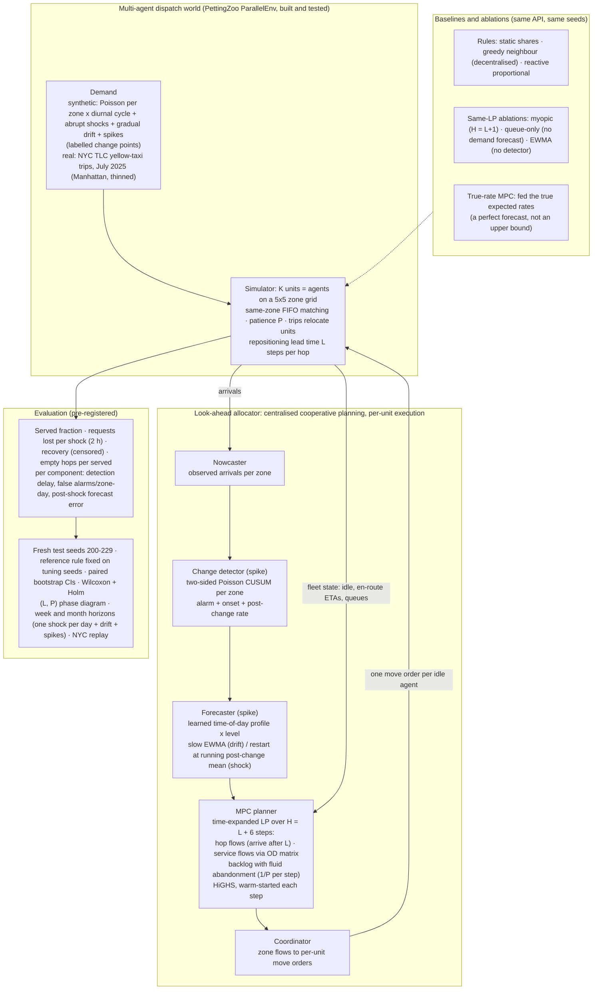

# Approach diagram (Round-1 optional 1-page architecture) — P7 regime-aware look-ahead allocator

**Reading guide.**
- **Each step:** arrivals are observed; the detector updates; the forecaster smooths (drift) or restarts (shock); the LP plans H steps ahead using known future supply (units about to free up); only the first step is executed. Then the loop repeats.
- **What the ablations isolate:**
  - *myopic* — the value of the planning horizon;
  - *queue-only* — the value of any demand forecast;
  - *EWMA* — the value of the change detector;
  - *true-rate MPC* — the most a better forecast could add.
- **The (L, P) sweep** shows where each layer pays.
