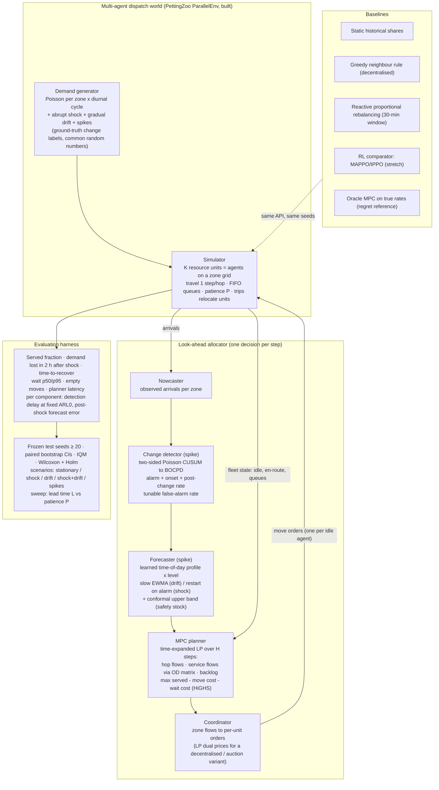

# Approach diagram (Round-1 optional 1-page architecture) — P7 shock-aware look-ahead allocator

**Reading guide.**
- One step of the loop, in order: arrivals are observed; the detector updates; the forecaster restarts or smooths; the MPC solves an H-step LP using the units that will free up; only the first step of the plan is executed; then the loop repeats.
- Rule-based baselines plug into the same API, which isolates the value of each layer:
  - planner without forecast,
  - forecast without detector,
  - detector + forecast + planner,
  - oracle.
