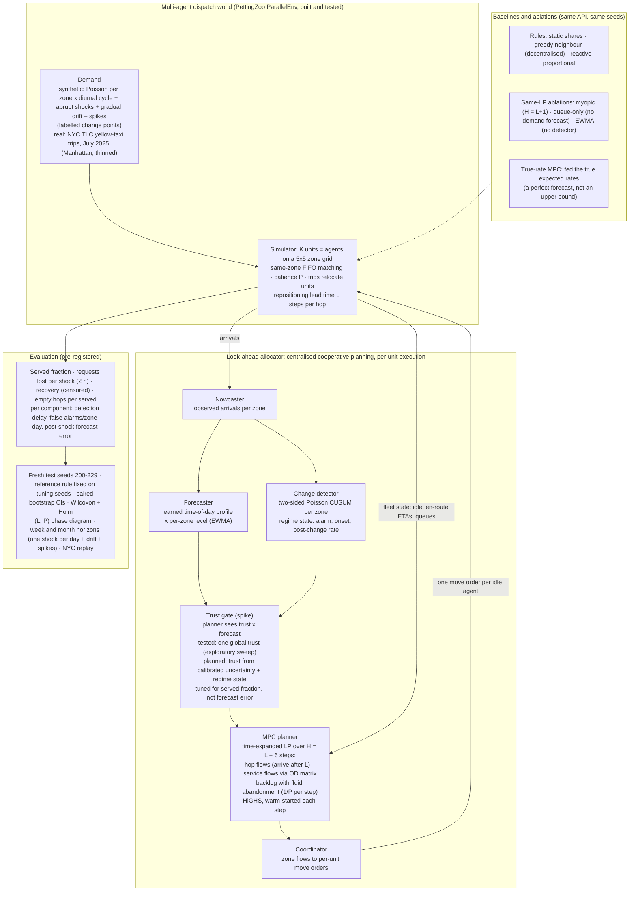

# Approach diagram (Round-1 optional 1-page architecture) — P7 decision-aware look-ahead allocator

**Reading guide.**
- **Each step:** arrivals are observed; the forecaster and the detector update; the trust gate scales the forecast per zone; the LP plans H steps ahead using known future supply (units about to free up) and the current queues; only the first step is executed. Then the loop repeats.
- **What the ablations isolate:**
  - *myopic* — the value of the planning horizon;
  - *queue-only* (trust 0) — the value of any demand forecast;
  - *trust 1* — certainty equivalence;
  - *true-rate MPC* — what a perfect forecast does inside this planner (it can hurt).
- **The (L, P) sweep** shows where each layer pays.
