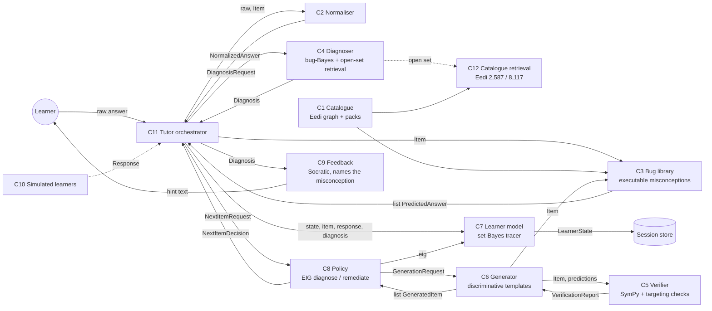

# Components and contracts — P8 misconception tutor

Contracts: [`contracts/models.py`](contracts/models.py) (pydantic v2, `CONTRACT_VERSION = 0.1.1`) and [`contracts/interfaces.py`](contracts/interfaces.py) (`typing.Protocol` per component). Contract tests: `components/tests/test_contracts.py` (`.venv/bin/python -m pytest components/tests`).

## Glossary
- **Misconception**: a systematic, predictable error pattern (Eedi's definition). Ids: `pack:<CODE>` for executable pack entries, `eedi:<id>` for the open catalogue.
- **Bug switch / bug program**: an executable change to one rule of an exact interpreter that reproduces the wrong answer a learner holding that misconception gives. Switches compose: several held misconceptions are modelled by switching several on.
- **Fires**: a bug fires on an item when it changes the answer.
- **Discriminative item**: every firing bug gives a different wrong answer, and none equals the key. One response then identifies the misconception.
- **Slip**: a non-systematic wrong answer that no held misconception predicts.
- **Session**: a sitting. Between sessions, misconceptions can remit or relapse.

## Dependency graph

## Components

| # | Component (folder) | Responsibility | Input → output (contracts) | Calls | Baseline (existing practice) | Isolated scalar metric | SLO | Status |
|---|---|---|---|---|---|---|---|---|
| C1 | Catalogue (`components/bugs`, `eval/data`) | Holds the misconception label space and links pack entries to Eedi ids | id → `Misconception` | — | Eedi Misconceptions Graph v1.0 (CC BY 4.0) | **Link coverage**: share of pack misconceptions with ≥1 verified Eedi id (now 5/5) | in-memory | built |
| C2 | Normaliser (`components/normalizer`) | Raw answer → canonical exact value | `str, Item` → `NormalizedAnswer` | — | `fractions.Fraction` parsing | **Canonicalisation accuracy** on a labelled answer-string set (now 8/8 contract cases; to grow) | <1 ms | built |
| C3 | **Bug library** (`components/bugs/school_math.py`) **[spike A]** | Predicts each misconception's wrong answer on an item (single and composite) | `Item` → `list[PredictedAnswer]`; `predict_set(Item, ids)` → `str|None` | — | Hand-written mal-rules (Sleeman; MalruleLib) | **Real-distractor reproduction rate**: share of Eedi distractors labelled with a pack misconception that the bug reproduces, plus **false-claim rate** on distractors labelled otherwise | <1 ms/item | built (5 bugs) |
| C4 | **Diagnoser** (`components/diagnoser`) **[spike A]** | Wrong answer → posterior over misconceptions + slip, or abstain | `DiagnosisRequest` → `Diagnosis` | C2, (C3 via request), C12 | LLM zero-shot classifier; Eedi-winner retrieval + rerank | **Closed-set accuracy** (5 categories, real Eedi distractors: LLM 86.0%, exec→LLM hybrid 86.8%, TF-IDF 38.0%); **MAP@25** (open set) | <5 ms exact; <3 s LLM | built (bug-Bayes, LLM, TF-IDF/BM25) |
| C5 | Verifier (`components/verifier`) | Independently checks key (SymPy), well-formedness, target firing, discrimination | `Item, list[PredictedAnswer]` → `VerificationReport` | SymPy | LLM self-check / none | **Fault-detection rate** on injected faults (wrong key, duplicate options, non-firing target) | <20 ms | built (mutation suite to add) |
| C6 | **Generator** (`components/generator`) **[spike A]** | New practice item targeted at a misconception and separating competitors | `GenerationRequest` → `list[GeneratedItem]` | C3, C5 | LLM-only generation (GPT-4.1-mini) | **Verified-targeted yield**: share of generated items whose key verifies *and* whose target bug fires (ours 400/400 by construction; LLM-only GPT-4.1-mini 40/40); plus discriminative rate | <50 ms/item | built |
| C7 | **Learner model** (`components/learner_model`) **[spike B]** | Exact Bayesian filter over *sets* of held misconceptions across sessions (2^K states), remission/relapse between sessions | `LearnerState, Item, Response, Diagnosis, predictions` → `LearnerState` | C2, C3 | Independent BKT per misconception; pyKT deep KT | **Exact-set diagnosis accuracy** after T items (simulation); next-answer log-loss on real option data (finals) | <10 ms/update (K=5) | built |
| C8 | **Policy** (`components/policy`) **[spike B]** | Diagnose with max expected information gain; remediate when P(misconception) ≥ 0.75 | `NextItemRequest` → `NextItemDecision` | C7.eig, C6 | Random practice; mastery-learning order | **Misconceptions still held after S sessions** (simulation) | <300 ms | built |
| C9 | Feedback (`components/tutor`) | Socratic hint naming the diagnosed misconception, contrasting the learner's answer with the bug's rule; never states an unverified number | `Diagnosis, Item` → text | LLM (optional), C3 | Generic "the answer is X" | **Rubric pass rate** (names misconception, no answer-giving, numbers verified) | <3 s | template version built; LLM version planned |
| C10 | Simulated learners (`components/simulator`) | Learners who execute bug switches, slip, learn from feedback, relapse (SYNTHETIC) | `Item, predictions` → `Response` | C3 | MathDial-style prompted LLM students (known not to stay wrong) | **Fidelity**: distance to Eedi option-choice statistics (finals) | — | built (program-based) |
| C11 | Tutor orchestrator (`components/tutor`) | Runs a session end to end; persists `LearnerState` per learner | CLI / API → session transcript | C2–C9 | — | **End-to-end**: misconceptions still held after S sessions; turn latency | <0.5 s/turn | built (CLI) |
| C12 | Open-set catalogue retrieval (`eval/run_diagnosis.py`, to move into `components/diagnoser`) | Ranks the 2,587-misconception Eedi corpus for any (question, distractor) | text → ranked ids | — | BM25, TF-IDF, kNN over labelled pairs; Eedi winners' Qwen retriever + reranker | **MAP@25** on held-out questions | <100 ms (lexical) | baseline built |

## Error modes (and what each component does)
- Unparseable answer → C2 returns `parse_ok=False`; C4 treats it as a slip candidate and the tutor asks again.
- No bug fires on the item → C4 returns slip/abstain; C8 picks an item with higher EIG.
- Two bugs predict the same wrong answer → C4 splits the posterior; C8 next picks a *discriminative* item (C6 with `competitor_ids`).
- Generator cannot satisfy constraints within `max_tries` → returns fewer items; C8 falls back to the item pool.
- LLM unavailable or rate-limited → `components/llm.py` raises `RateLimited`; diagnosis falls back to the executable path; open-set falls back to lexical retrieval.

## Spike choice
See [ADR 001](adr/001-spike.md). Spike A: executable misconceptions → exact diagnosis + verified *discriminative* generation (C3, C4, C6). Spike B: set-Bayes tracing + EIG policy (C7, C8). Everything else follows best existing practice.

## Measured against frontier LLMs (pre-registered, 4 Oct 15:21 IST; `eval/llm_gap_protocol.md`)
- **C4:** on real Eedi data, GPT-5.5 diagnosed 79.4% of positives with 0.0% false claims, against the engine's 19.1% with 0.0%. C4 is therefore an **exact-first cascade**: engine first, the LLM on abstentions (`eval/run_cascade.py`, `eval/run_prob_pack.py --task diag`).
- **C6:** for LLM-only probability answers, the key and the misconception answer were *both* exact 36.7% (GPT-4.1-mini), 96.7% (GPT-5.4-mini) and 100.0% (GPT-5.5) of the time; the GPT-4.1-mini key alone was exact 40.0%. Our probability answers come from closed-form family formulas and are not SymPy-verified. Our arithmetic keys are SymPy-verified.
- **C7:** synthetic tracing, exact held set: tracer 64.0% vs GPT-5.4-mini 66.0%, not significantly different.

## Changelog
- 0.1.0 (05:00 IST, 4 Oct): initial contracts.
- 0.1.1 (05:30 IST, 4 Oct): `DiagnosisRequest.prior`, `LearnerState.model_state`, `ComposableBugLibrary.predict_set`; `Item.construct` renamed `construct_name` (it shadowed a pydantic attribute).
