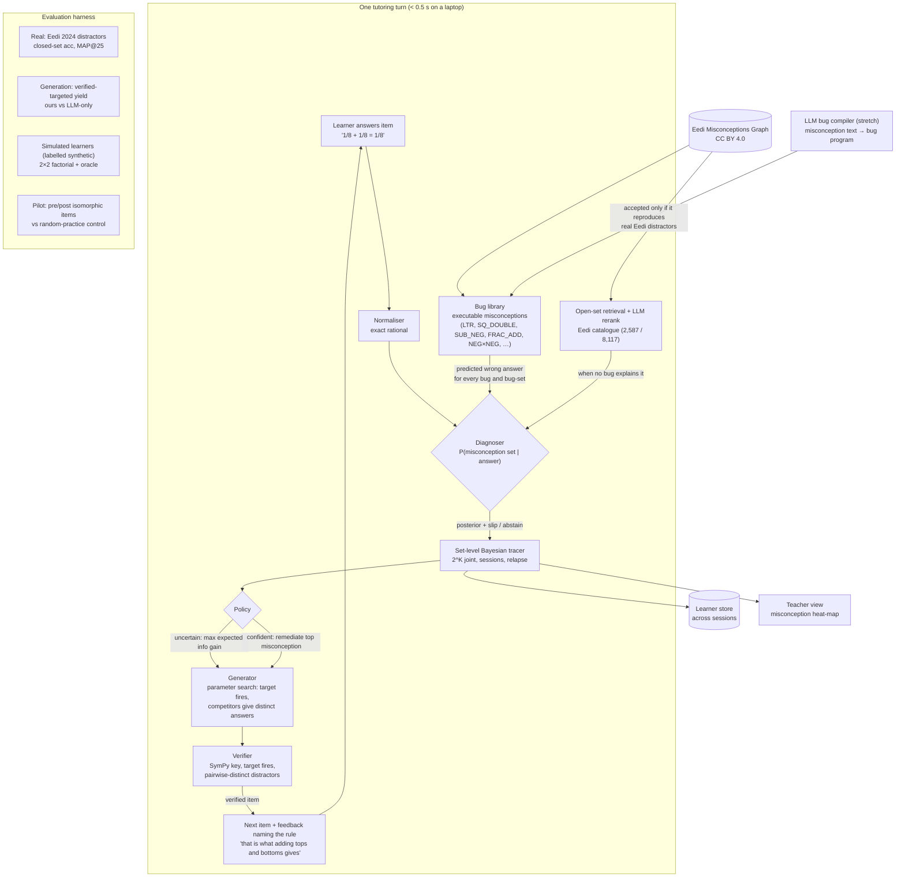

# Architecture — "Find the rule you're actually using"

*One page for the Round-1 submission (optional diagram). Component contracts: [`../architecture/components.md`](../architecture/components.md).*

**Reading the diagram.** A wrong answer is treated as the *output of a procedure*. Every misconception in the library is an executable change to one rule of an exact interpreter, so the system knows exactly which wrong answer each misconception, or each *combination* of them, produces. Diagnosis is Bayesian inversion of those programs, with an explicit "just a slip" hypothesis. The next item is either the most informative one (while uncertain) or a targeted practice item (once confident). Each item is generated so the target misconception fires and competing misconceptions give *different* wrong answers. It is then checked independently by SymPy before any learner sees it.
