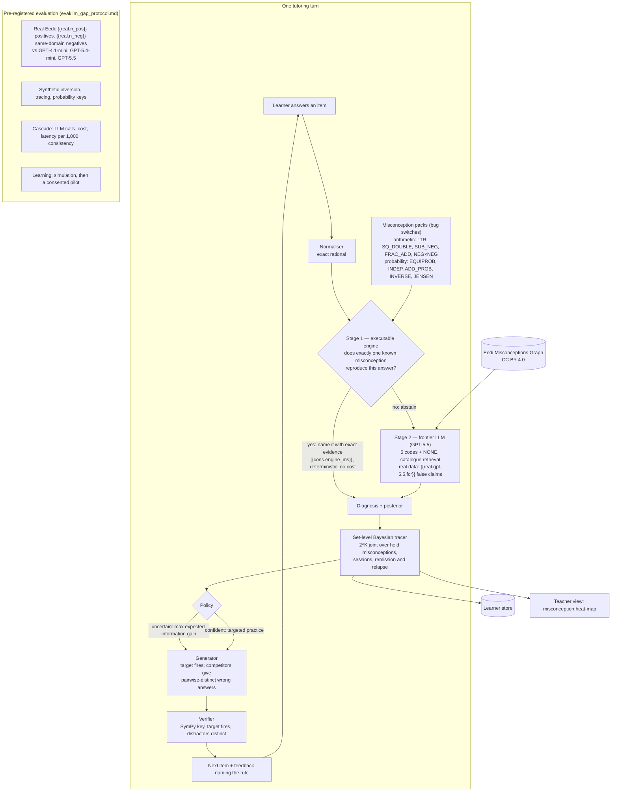

# Architecture — exact-first cascade tutor (P8)

*The one-page diagram for the Round-1 submission. Component contracts: [`../architecture/components.md`](../architecture/components.md). Numbers are rendered from committed results by `python -m eval.render_docs`.*

**Reading the diagram.** A wrong answer is treated as the output of a procedure.
- **Stage 1.** Every misconception in a pack is an executable change to one rule of an exact interpreter. So when one of them reproduces the learner's answer, the system can say so with proof, instantly and identically every time.
- **Stage 2.** Everything else goes to a frontier LLM. On real Eedi data GPT-5.5 made no false claims on same-domain negatives, so it is a safe second stage.
- **Tracing and practice.** The tracer keeps a posterior over which *combination* of misconceptions the learner holds. Generated practice is built so that the targeted misconception and its competitors give different wrong answers, and SymPy verifies every key before a learner sees it.
