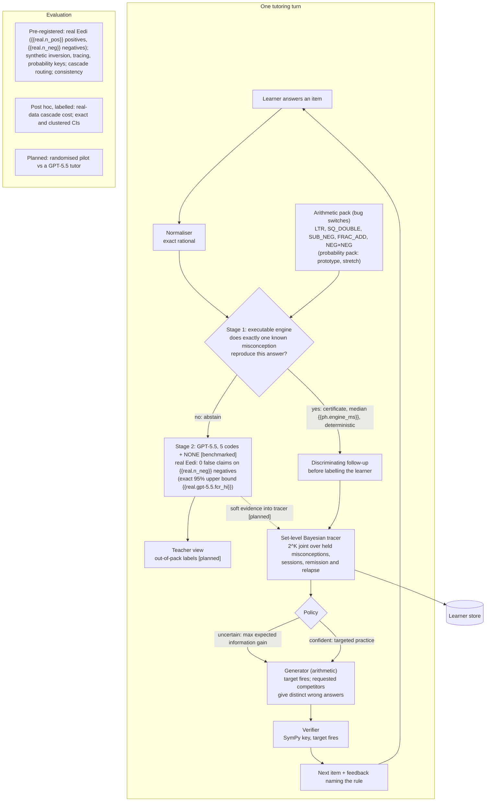

# Architecture — exact-first cascade tutor (P8)

*The one-page diagram for the Round-1 submission. Component contracts: [`../architecture/components.md`](../architecture/components.md). Numbers are rendered from committed results by `python -m eval.render_docs`.*

**Legend:** solid boxes are **built** (they run in the CLI today); `[benchmarked]` parts were evaluated standalone in `eval/`; `[planned]` parts are not built yet.

**Reading the diagram.**
- **Stage 1 (certificate).** A wrong answer is treated as the output of a procedure. When exactly one programmed misconception reproduces it, the system has a *certificate*: "this rule gives this answer". That is not proof of what the learner believes, so it follows up with a discriminating item before labelling.
- **Stage 2 (LLM).** Everything else goes to GPT-5.5. On our real Eedi benchmark it made no false claims, an observation on 152 selected items, not a guarantee.
- **Tracing and practice.** The tracer keeps a posterior over which *combination* of the pack's misconceptions the learner holds. Generated arithmetic practice is verified by SymPy before a learner sees it.
