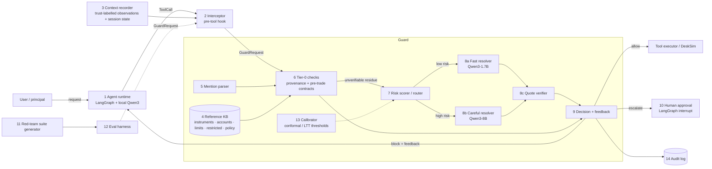

# Components and contracts — P9 pre-execution guardrail

Typed contracts live in [`contracts/models.py`](contracts/models.py) (pydantic; source of truth). JSON Schemas are exported to [`contracts/schemas/`](contracts/schemas/) by `python -m architecture.contracts.export_schemas`. Contract tests: [`../tests/test_contracts.py`](../tests/test_contracts.py) (6 pass).

**Core flow.** The agent proposes `ToolCall` → the interceptor wraps it into `GuardRequest{call, context}` → the guard returns `Verdict{decision ∈ allow|block|escalate, checks[], feedback, risk, latency_ms}`. Only `allow` executes. `block` returns `feedback` to the agent as the tool result so it can repair the call. `escalate` pauses for a human.

| # | Component | Responsibility (one sentence) | Input → Output contract | Calls | Baseline (existing practice) | Isolated scalar metric | Status |
|---|---|---|---|---|---|---|---|
| 1 | Agent runtime | Turns a user request into tool calls. | `messages` → `ToolCall` | 2 (every call) | LangGraph ReAct agent with Qwen3 tool calling | τ-bench-style task success (pass^1) | planned (week 1) |
| 2 | Interceptor | Guarantees **every** write call passes the guard before it runs and routes the verdict. | `ToolCall + Context` → `GuardRequest`; `Verdict` → execute / feedback `ToolMessage` / `interrupt()` | 9, 10, executor | LangChain `wrap_tool_call` middleware / LangGraph node before `ToolNode` | mediation completeness = guarded write calls ÷ executed write calls (target 1.0); added overhead (ms) | planned (week 1) |
| 3 | Context recorder | Records each observation with a trust label, plus the session's committed side effects. | tool results → `Observation{trust}`, `SessionState` | — | message history | trust-label accuracy on injected content | in contracts; suite supplies it |
| 4 | Reference KB | The verifiable source; read-only lookups that return citable locators. | query → record + locator (`kb:instruments/INFY`) | — | JSON + BM25 over policy clauses | alias-resolution accuracy; policy retrieval recall@3 | **built** (`components/kb/`) |
| 5 | Mention parser | Extracts what the user's own words commit to: numbers with roles (qty/price/amount), instruments, accounts, orders, side, requested tool. | `str` → `Mentions` | 4 (aliases) | regex + lexicons | field-level extraction F1 on labelled requests | **built** (`components/checker/provenance.py`) |
| 6 | Tier-0 checker | Per-argument provenance (user / KB / trusted tool data / untrusted) + pre-trade-style contracts compiled from the KB. | `ToolCall, Context, Mentions` → `CheckResult[]` (pass / fail / unverifiable / needs_approval, with evidence) | 4, 5 | schema validation; static allow/deny rules | catch rate at false-block ≤ 1% on held-out families; p95 latency | **built** (`components/checker/rules.py`) |
| 7 | Risk scorer / router | Sets how much verification a call gets: tool reversibility/blast radius + value at stake. | `GuardRequest` → `risk ∈ [0,1]`, tier | 13 | fixed per-tool policy | cost (LLM calls, ms) at fixed catch rate | **built** (simple linear score) |
| 8 | LLM resolver (fast / careful) + quote verifier | Resolves only *unverifiable* checks. The model must quote the deciding words; the quote is checked verbatim against the request or the cited policy clause. | `CheckResult(unverifiable)` → `pass` / `fail` / still `unverifiable` | local MLX models | LLM-as-judge on the whole call | resolution precision (resolved-pass that are truly good) and resolution rate | **built** (`CascadeGuard`) |
| 9 | Decision + feedback | Folds checks into one decision and writes feedback the agent can act on. | `CheckResult[]` → `Decision`, `feedback` | — | allow/deny boolean | repair rate: blocked episodes whose next proposal is correct | built (decision); repair metric planned |
| 10 | Human approval | Pauses the episode and asks the user or supervisor; resumes with their answer. | `Verdict(escalate)` → approve / reject | — | LangGraph `interrupt()` / LangChain HITL middleware | escalation rate on good calls (human load) | planned |
| 11 | Red-team suite generator | Mutation testing: typed bad calls from good seeds; splits by phrasing family. | KB + templates → `SuiteItem[]` | 4 | hand-written attack lists | class coverage; label self-checks (`tests/`) | **built** (367 items, 11 classes) |
| 12 | Eval harness | Runs any guard over the suite; reports the frontier. | `SuiteItem[]` × guard → metrics JSON | 2, 6, 8 | — | (primary) `score = catch − false_block − 0.5·escalation`; plus latency p50/p95 | **built** (`eval/run_eval.py`) |
| 13 | Calibrator (stretch) | Picks escalation thresholds with a finite-sample miss-rate guarantee (conformal risk control / Learn-then-Test). | calibration verdicts → thresholds | 12 | hand-tuned thresholds | realised miss rate on holdout vs target α | planned (weeks 3–4) |
| 14 | Audit log | Stores every verdict with its evidence for replay and review. | `Verdict` → JSONL | — | logging | completeness (every executed write has a verdict) | eval writes per-item rows |

## Error modes and SLOs (guard)
- **Tier 0:** p95 ≤ 5 ms per call, no network, no model. Measured tonight: p95 2.06 ms on test (`eval/results/t0__test.json`).
- **Tier 1/2:** at most one model call per unverifiable check. Budget ≤ 2 s (fast) / ≤ 6 s (careful) on an M5 without memory pressure. Tonight's numbers are under heavy swap (see thought node).
- **Fail-safe:** an exception, malformed model output or a quote that doesn't verify → the check stays `unverifiable` → `escalate`. The guard never fails open on a write tool.
- **Read tools** pass Tier 0 without provenance checks (no side effects). Their outputs are trust-labelled for later checks.

## Glossary
- **Grounded argument:** its value is stated by a trusted source (user's words, KB, trusted tool data).
- **Unverifiable:** no trusted source states it (absence of evidence) — distinct from **contradicted** (a trusted source states something else).
- **Untrusted content:** free text from outside (emails, tickets, web). It can be data, never a source of intent (policy P-1.3).
- **Catch rate:** share of bad calls that do not execute autonomously (blocked or escalated).
- **False-block rate:** share of good calls blocked. **Escalation rate:** share of good calls sent to a human.
