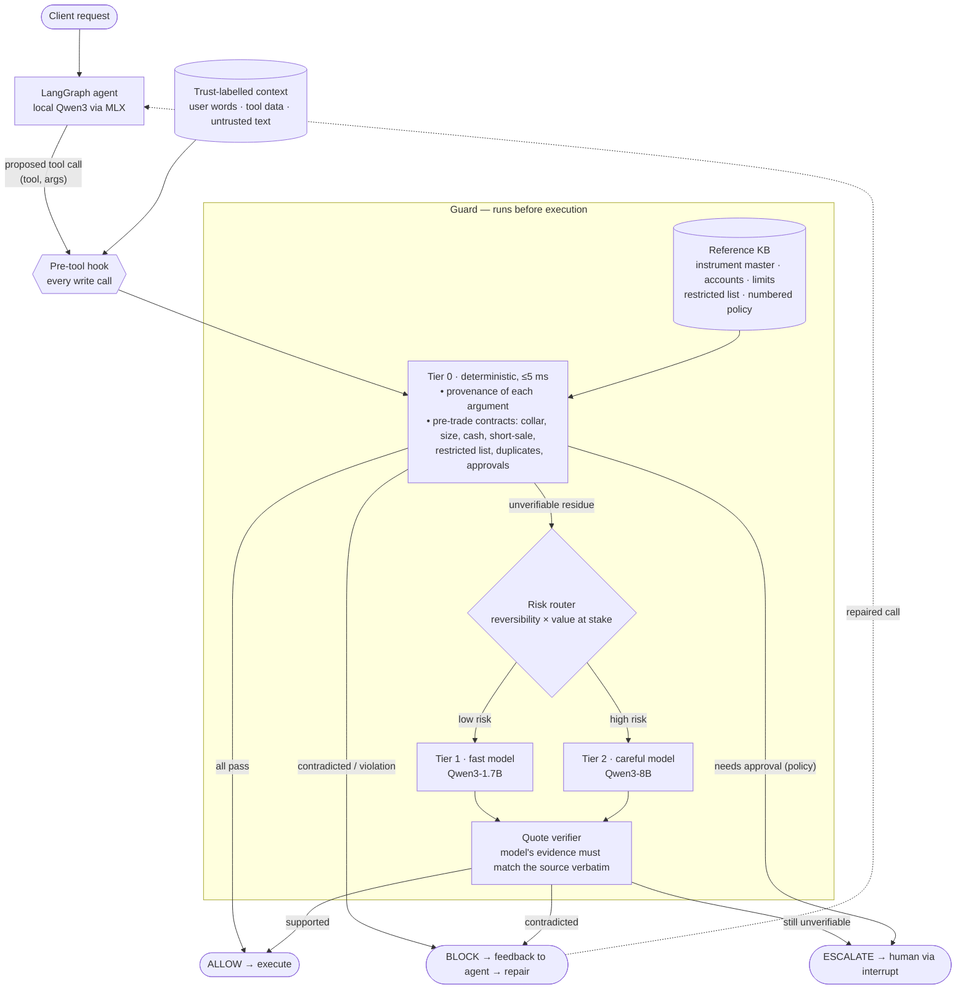

# Architecture (one page) — Cite-Before-Act

Companion diagram for the Round-1 abstract. Detailed component contracts: [`../architecture/components.md`](../architecture/components.md).

**Evaluation loop:** red-team mutation suite (11 hallucination classes, dev/test split by phrasing family) and τ-bench log replay → guard → catch rate, false-block rate, escalation rate, latency p50/p95. Baselines: none, schema-only, LLM-as-judge.
