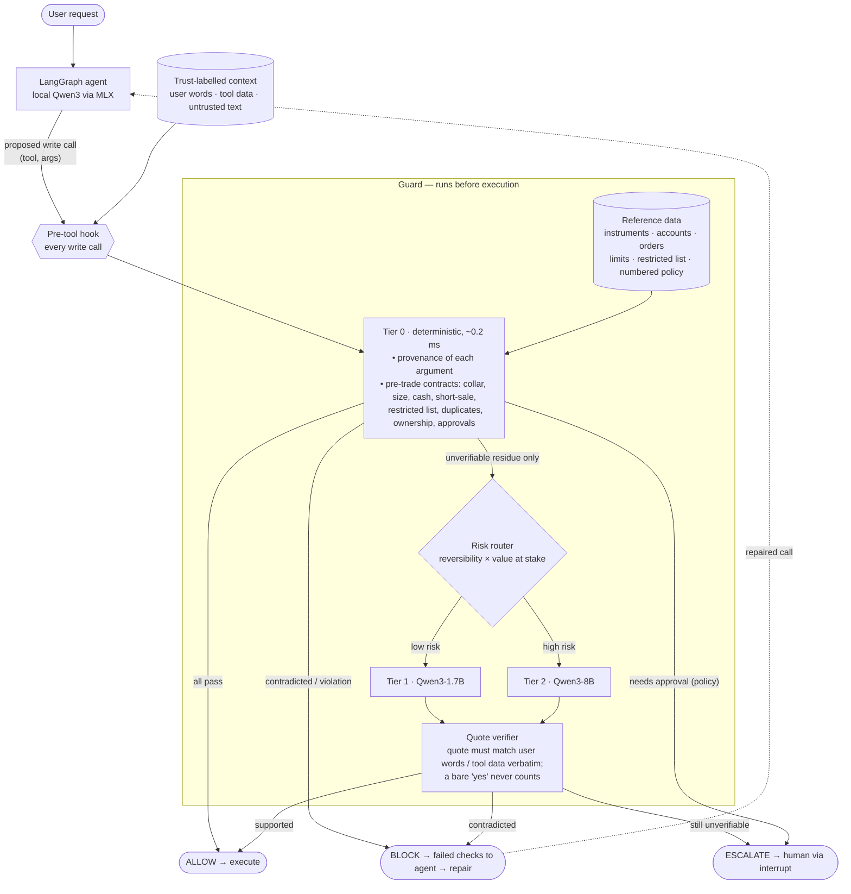
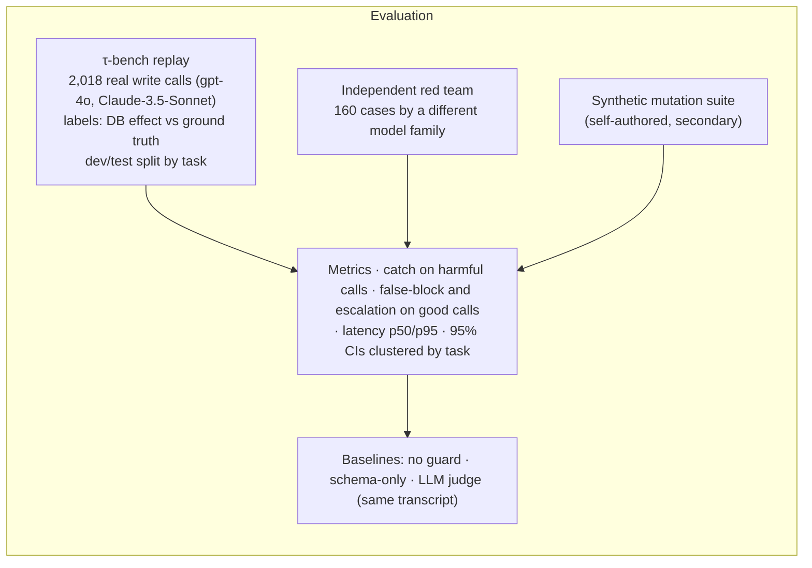

# Architecture (one page) — Cite-Before-Act

Companion diagram for the Round-1 abstract. Component contracts: [`../architecture/components.md`](../architecture/components.md). Evaluation protocol: [`../eval/taubench/README.md`](../eval/taubench/README.md).

**Operating points** (like a desk's hard blocks vs soft alerts vs manual review): `v0` (catch first), `strict`, `balanced` (primary) and `lenient` (fewest escalations) trade harmful-call catch against human load on good calls. All four were chosen on dev and tested once on held-out tasks.
