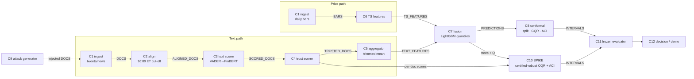

# P10 component map

Every component is a pure function over typed DataFrames. _v1, 4 Oct ~13:05 IST: trust made deletion-stable, ACI made exact, attacks enriched (see `research/notes/review-adr001-rubber-duck.md`). Headline results: `eval/results/text_minilm_v1.md`._ The contracts (columns, dtypes, value checks, keys) live in [`contracts/contracts.py`](contracts/contracts.py) and are enforced at every hand-off by `validate(df, CONTRACT)`; a violation raises `ContractError`. Code: `components/<name>/`. Baselines are what runs in the walking skeleton tonight; numbers come from [`eval/results/baseline_v0.json`](../eval/results/baseline_v0.json).

| # | Component | Responsibility (one sentence) | Input → output contract | Calls | Baseline tonight | Isolated scalar metric | Error modes |
|---|---|---|---|---|---|---|---|
| C1 | `ingest` | Load raw documents and daily bars into canonical tables. | files → `DOCS`, `BARS` | — | StockNet raw JSON + Yahoo CSV | rows parsed / rows present; contract pass | malformed JSON (skipped), bad prices (dropped) |
| C2 | `align` | Assign each document to the trading day whose 16:00 America/New_York close it precedes. | `DOCS` + trading days → `ALIGNED_DOCS` | — | DST-aware cut-off, weekend/holiday roll-forward | **look-ahead leaks = 0** (measured: 0 of 119,641) | timezone/DST bugs, docs after last day (dropped) |
| C3 | `text_scorer` | Score each document's financial sentiment in [−1, 1] with class probabilities. | `ALIGNED_DOCS` → `SCORED_DOCS` | model (cached by text hash) | VADER + 40-term finance lexicon (heuristic); FinBERT wrapper ready | macro-F1 on a labelled financial-tweet set (not yet run) · IC of mean sentiment with next-day return | sarcasm, cashtag spam, look-ahead in LLM scorers (LAP) |
| C4 | `trust_scorer` | Weight each document by credibility from its *own* account metadata (age, followers, verified, cashtag spam); the copy-paste cluster size is kept as a detection signal only, because trust must be deletion-stable for C10. | `SCORED_DOCS` → `TRUSTED_DOCS` | — | transparent heuristic | AUROC of 1−trust for injected vs real docs (weak-bot and metadata-mimic attackers) | attackers mimicking metadata (so the certificate does not rely on trust) |
| C5 | `aggregator` | Collapse a ticker-day's documents into bounded-influence text features. | `TRUSTED_DOCS` + panel → `TEXT_FEATURES` | — | count, mean, 20 % trimmed mean, std, trust-weighted mean, trust mean, attention z | worst-case feature shift under k injected docs at equal IC | days without docs (zeros + `n_docs`=0) |
| C6 | `ts_features` | Price, volatility, volume and market features up to the close of t; target y = next-day log return (%). | `BARS` → `TS_FEATURES` | — | lags r0–r4, rv5, rv20, Parkinson, volume z, market return/vol | pinball loss of price-only model on validation | survivorship (StockNet's fixed 88-name universe) |
| C7 | `fusion` | Predict the α/2, 0.5, 1−α/2 quantiles of y from text + price features. | `TEXT_FEATURES` ⋈ `TS_FEATURES` → `PREDICTIONS` | — | LightGBM quantile ×3 (300 trees, 15 leaves, seed 0) | mean pinball loss; Spearman IC of the median | quantile crossing (sorted), over-fit to 2014 |
| C8 | `conformal` | Calibrate intervals with an off-the-shelf method (the Minimum Viable). | `PREDICTIONS` + calibration y → `INTERVALS` | MAPIE 1.5.0 | split CP, CQR (MAPIE); our own ACI loop on CQR scores (per day; no clipping; whole line at α_t ≤ 0, empty set at α_t ≥ 1) | \|coverage − 0.9\| and mean width on the time-ordered test set | exchangeability breaks in new regimes (measured) |
| C9 | `attack` | Generate manipulation scenarios within a stated budget. | `DOCS` → `DOCS` with `source=injected` | C3 (to score templates) | pump (k bullish posts from fresh accounts; trust from C4) · 53-variant oracle grid incl. mixed signs (k ≤ 3) · bursts on pre-specified days | coverage drop and median shift caused | attacker unknown to the defender |
| C10 | `robust_conformal` **(spike)** | Certified-robust CQR: interval valid for every attack that injects ≤ k documents, + ACI for drift. | `PREDICTIONS` (trees) + per-doc scores → `INTERVALS` | C7 trees, C5 rules, C8 offset | deletion-box over ≤k removals → tree interval propagation → `[LB−Q, UB+Q]` | **width at certified coverage** (lower is better; coverage ≥ clean CQR by construction) | box looseness (width cost), float round-off (ε-widened) |
| C11 | `eval` (frozen) | Score interval forecasts. | `INTERVALS` + y → metrics dict | — | coverage, width, Winkler, Kupiec, Christoffersen, worst-day, by regime | — (it *is* the metric) | pooled tests ignore same-day correlation (stated) |
| C12 | `decision` / demo | Turn intervals into actions and a judge-facing dashboard. | `INTERVALS` → positions / UI | — | not built yet | hit rate / Sharpe of "trade only if interval excludes 0" | — |

## SLOs (finals build)
- Daily batch for ~100 tickers in < 60 s on the M5 (tonight: data prep 35 s for 119,641 tweets with VADER; full evaluation incl. oracle attack ≈ 10 min).
- Certified interval for one ticker-day in < 50 ms (tree propagation is vectorised; box is O(k·n)).
- Contract tests pass on every hand-off; look-ahead leaks = 0.

## Seams for swapping (what the ratchet loops change)
- C3: VADER → FinBERT (`ProsusAI/finbert`, `yiyanghkust/finbert-tone`) → small LLM via MLX (only with a post-cutoff test, see landscape §3).
- C5: trimmed fraction, extra robust features (median-of-means, attention z); every new feature must come with an exact deletion-range rule for C10.
- C7: monotone constraints on text features (tighter certificates), fewer trees touching text features.
- C8/C10: ACI step size, conditional (regime-group) conformal from MAPIE 1.5.
