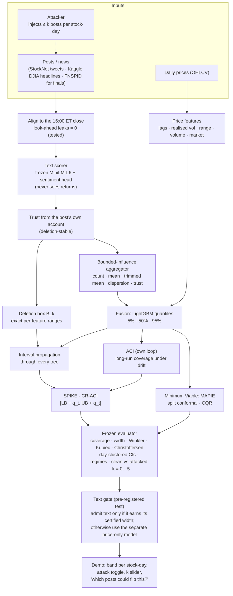

# P10 architecture — one page (optional diagram for the Round 1 abstract)

**Guarantee in one line:** if at most k of a stock-day's posts are injected, the clean features lie in the deletion box, so *at a fixed offset* the certified interval contains the interval the clean model would have produced — an attacker within budget cannot add misses. ACI separately keeps long-run mean daily coverage near 1 − α under drift; separately adapted clean and attacked ACI runs need not be nested.

**Measured trade-off:** what the text channel buys (pre-registered test on unseen data) against what it costs (certified width at budget k). Results: `eval/results/text_minilm_v1.md`, `eval/results/text_utility_djia_v1.md`.
