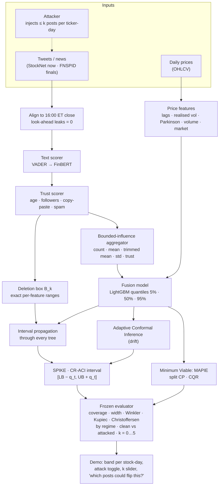

# P10 architecture — one page (optional diagram for the Round 1 abstract)

**Guarantee in one line:** if at most k of a ticker-day's documents are injected, the clean feature vector lies in the deletion box, so the CR-ACI interval contains the interval the clean model would have produced; ACI keeps long-run coverage at 1 − α under drift.
